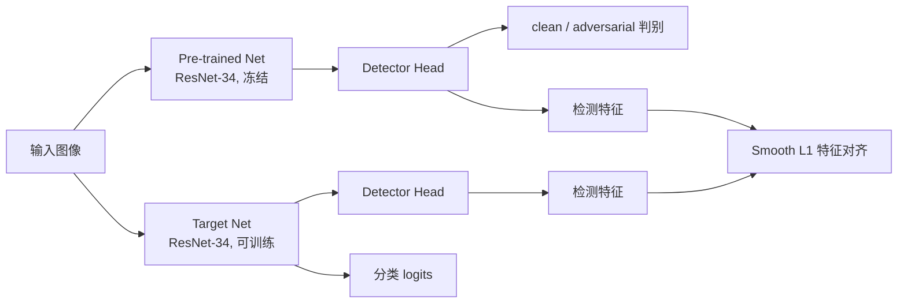

# A Simple Structure For Building A Robust Model

论文 **A Simple Structure For Building A Robust Model** 的作者实现。项目基于 CIFAR-10 和 ResNet-34，提供了一套“**离线生成多种对抗样本 + 对抗样本检测头协同训练**”的模型鲁棒性提升流程。

- 论文：*A Simple Structure For Building A Robust Model*
- 作者：Xiao Tan, Jingbo Gao, Ruolin Li
- 会议：ICIS 2022（Intelligence Science IV, IFIP AICT vol. 659, pp. 417–424）
- arXiv：<https://arxiv.org/abs/2204.11596>
- DOI：<https://doi.org/10.1007/978-3-031-14903-0_45>
- HAL：<https://hal.science/hal-04666419>

## 方法简介

论文的核心思路是在普通对抗训练的基础上加入一个轻量的**对抗样本检测头**（Detector Head），让检测任务和分类任务协同训练：



图中 `H1`、`H2` 是同一个检测头模块的两次调用，参数共享。

训练时主要包含三部分损失：

```
L = α · CrossEntropy(train_net(x), y_cls)
  + β · SmoothL1(head_feat(train_net_features), stopgrad(head_feat(pre_net_features)))
  + CrossEntropy(head(pre_net_features), y_adv)
```

其中：

- `Pre-trained Net` 在干净数据上预训练，训练过程中冻结；
- `Target Net` 与 `Pre-trained Net` 结构相同，是真正参与对抗训练和最终分类的网络；
- `Detector Head` 以网络中间层特征图为输入，判断样本是干净样本还是对抗样本；
- 检测头的分类损失单独反传更新检测头；
- 目标网络的分类损失和 Smooth L1 特征对齐损失用于更新目标网络，从而把检测任务学到的信息反馈给分类网络；
- `α = --im-loss-weight`，`β = --diff-loss-weight`。

数据方面，项目采用**离线生成对抗样本 + 随机混合采样**：

1. 对训练集中的每张图片，预先使用多种攻击生成对抗样本并保存为 ImageFolder；
2. `AdvMixDataset` 为每个样本按 `--adv-ratio` 随机选择干净样本或对抗样本；
3. 选择对抗样本时，会在多种攻击类型之间按权重随机选择；
4. 验证集使用确定性的混合方式，保证评估结果稳定。

支持的攻击类型：`FGSM`、`BIM`、`DeepFool`、`CWL2`、`Noise`、`NST`。

## 项目结构

```text
.
├── aisafe_glaring/
│   ├── aisafe_generate_dataset.py   # 生成 CIFAR-10 ImageFolder 数据集
│   ├── aisafe_train_resnet.py       # 训练干净数据上的 ResNet-34
│   ├── aisafe_adv_samples.py        # 离线生成对抗样本
│   ├── aisafe_train_adv_model.py    # 普通对抗训练（基线）
│   ├── aisafe_train_fuse_model.py   # 检测头 + 目标网络协同训练
│   ├── aisafe_test_models.py        # 分类 / 对抗样本检测测试
│   └── aisafe_analyse_tf_log.py     # 训练曲线可视化辅助脚本
├── models/
│   ├── resnet.py                    # ResNet 及多级特征输出
│   ├── glaring_net.py               # GlaringNet 与多个版本的检测头
│   └── densenet.py                  # DenseNet（当前主流程未使用）
├── lib/
│   ├── dataset.py                   # AdvMixDataset：干净 / 对抗样本混合采样
│   ├── adversary.py                 # DeepFool、C&W 等攻击实现
│   ├── transforms.py                # 数据变换
│   └── ...
├── dowdyboy_lib/                    # 日志、随机种子、数据集工具
├── pre_trained/
│   └── my_resnet34_cifar10.pth      # CIFAR-10 干净数据 ResNet-34 预训练权重
├── run_train_resnet.sh              # 训练干净 ResNet-34 的入口
├── run_adv_samples.sh               # 生成对抗样本的入口
├── run_train_fuse_model.sh          # 协同训练模型的入口
├── data_loader.py                   # 通用数据加载工具（主流程可选）
├── calculate_log.py                 # OOD / 检测指标计算工具
├── lib_generation.py                # 特征生成与 LID 工具
└── lib_regression.py                # OOD 检测回归工具
```

> `calculate_log.py`、`lib_generation.py`、`lib_regression.py` 等文件主要来自 OOD 检测相关工作，不是本论文主流程的必需部分；其中 `calculate_log.py` 使用了较旧版本的 `scipy.misc`，在新版 SciPy 下可能无法直接运行。`lib/quilting.py` 依赖额外的 `findseam` 动态库，主流程同样未使用。

## 环境准备

建议使用 Linux 或 WSL，并配备 NVIDIA GPU。也可以在 Windows 原生环境运行，但如遇到 DataLoader 多进程问题，请把 `--num-workers` 设为 0。

- Python 3.9+（以所用 PyTorch / accelerate 版本的要求为准）
- PyTorch + torchvision（建议使用与本机 CUDA 匹配的版本）
- accelerate
- tensorboard
- tqdm、numpy、Pillow、scipy、scikit-image、matplotlib

示例安装命令：

```bash
conda create -n robust python=3.9 -y
conda activate robust

# 请根据本机 CUDA 版本选择对应的 PyTorch 安装命令
pip install torch torchvision
pip install accelerate tensorboard tqdm numpy pillow scipy scikit-image matplotlib
```

项目中的 `.sh` 脚本会设置 `PYTHONPATH`。如果直接运行 Python 脚本，需要把项目根目录加入 `PYTHONPATH`：

```bash
# Linux / macOS / Git Bash
export PYTHONPATH="$PWD:$PYTHONPATH"
```

```powershell
# Windows PowerShell
$env:PYTHONPATH = "$PWD;$env:PYTHONPATH"
```

## 数据准备

项目使用 ImageFolder 格式，目录结构如下：

```text
data/
├── cifar10-data/                    # torchvision 自动下载的原始 CIFAR-10
├── cifar10_image_folder/
│   ├── train/
│   │   ├── airplane/
│   │   ├── automobile/
│   │   └── ...
│   ├── val/
│   │   └── ...
│   └── test/
│       └── ...
└── adv/
    ├── train/
    │   ├── FGSM/
    │   │   ├── airplane/
    │   │   └── ...
    │   ├── BIM/
    │   └── ...
    └── val/
        └── ...
```

生成 CIFAR-10 ImageFolder，并从训练集中划分 10% 作为验证集：

```bash
python -c "from dowdyboy_lib.dataset_util import generate_cifar10_image_folder, split_val_dataset_image_folder; generate_cifar10_image_folder('data/cifar10-data', 'data/cifar10_image_folder'); split_val_dataset_image_folder('data/cifar10_image_folder/train', 'data/cifar10_image_folder/val')"
```

该命令只需运行一次；重复执行 `split_val_dataset_image_folder` 会继续从训练集中移动文件到验证集。

生成后大约为：

- `train`：45,000 张
- `val`：5,000 张
- `test`：10,000 张

主流程默认使用 `train` 和 `val`；`test` 目录可以留作额外评估。

也可以取消 `aisafe_glaring/aisafe_generate_dataset.py` 中调用代码的注释后执行。

> 对抗样本目录必须与干净数据目录保持相同的类别子目录、相同的样本数量和文件名顺序。`AdvMixDataset` 会使用同一个索引同时访问干净数据集和对抗数据集。训练集和验证集需要分别生成对抗样本。

## 快速开始

以下命令默认在项目根目录执行。

整体流程：

```text
生成 ImageFolder 数据
        ↓
训练干净 ResNet-34（或使用 pre_trained 权重）
        ↓
离线生成多种对抗样本
        ↓
┌───────────────────────────────┐
│ 可选：普通对抗训练（基线）      │
│ 论文方法：检测头协同训练        │
└───────────────────────────────┘
        ↓
测试分类准确率 / 对抗样本检测准确率
```

### 1. 训练干净数据上的 ResNet-34

```bash
bash run_train_resnet.sh \
  --model-depth 34 \
  --num-classes 10 \
  --img-size 32 \
  --train-dir data/cifar10_image_folder/train \
  --val-dir data/cifar10_image_folder/val \
  --out-dir output/resnet34_clean \
  --epoch 150 \
  --batch-size 64 \
  --lr 0.01 \
  --step-size 50 \
  --gamma 0.1
```

如果不想重新训练，可以直接使用仓库中的预训练权重：

```text
pre_trained/my_resnet34_cifar10.pth
```

训练结果保存在 `output/resnet34_clean/checkpoints/`，最佳模型文件名形如：

```text
best_model_epoch_123.pth
```

### 2. 离线生成对抗样本

先确保日志目录存在（脚本不会自动创建日志文件的父目录）：

```bash
mkdir -p output/adv
```

`--checkpoint` 使用上一步训练出的干净模型，或仓库中的 `pre_trained/my_resnet34_cifar10.pth`。以 FGSM 为例：

```bash
bash run_adv_samples.sh \
  --data-dir data/cifar10_image_folder/train \
  --out-dir data/adv/train/FGSM \
  --log-file output/adv/train_FGSM.log \
  --checkpoint pre_trained/my_resnet34_cifar10.pth \
  --adv-type FGSM \
  --adv-noise 0.005 \
  --img-size 32 \
  --num-classes 10 \
  --batch-size 8
```

对其他攻击重复执行，修改 `--adv-type`、`--adv-noise` 和 `--out-dir` 即可。论文中使用的扰动强度如下：

| 攻击类型 | `--adv-type` | 论文扰动强度 |
| --- | --- | --- |
| 高斯噪声 | `Noise` | 0.1 |
| FGSM | `FGSM` | 0.005 |
| BIM | `BIM` | 0.001 |
| DeepFool | `DeepFool` | 0.1 |
| C&W | `CWL2` | 0.005 |
| NST | `NST` | 0.1 |

注意事项：

- `--adv-noise` 在不同攻击中的含义不同：Noise 是高斯噪声标准差，FGSM/BIM 是步长，DeepFool 是步长，NST 是优化学习率；
- 当前代码中的 `CWL2` 分支使用固定的 C&W 权重，`--adv-noise` 实际上不会影响该攻击；
- 生成验证集对抗样本时，把 `--data-dir` 换成 `data/cifar10_image_folder/val`，输出目录换成 `data/adv/val/<攻击名>`，`--log-file` 也换成对应的验证集日志。

生成每种攻击的训练集和验证集对抗样本后，`data/adv` 的目录应与干净的 `data/cifar10_image_folder` 保持一一对应。

### 3. 普通对抗训练（基线）

> 以下直接调用 Python 的命令假设已经设置好 `PYTHONPATH`。Linux / Git Bash 也可以临时写成 `PYTHONPATH=. python ...`；Windows PowerShell 请先执行上文的 `$env:PYTHONPATH` 设置。

```bash
PYTHONPATH=. python aisafe_glaring/aisafe_train_adv_model.py \
  --train-dir-list \
    data/cifar10_image_folder/train \
    data/adv/train/FGSM \
    data/adv/train/BIM \
    data/adv/train/DeepFool \
    data/adv/train/CWL2 \
    data/adv/train/Noise \
    data/adv/train/NST \
  --val-dir-list \
    data/cifar10_image_folder/val \
    data/adv/val/FGSM \
    data/adv/val/BIM \
    data/adv/val/DeepFool \
    data/adv/val/CWL2 \
    data/adv/val/Noise \
    data/adv/val/NST \
  --out-dir output/resnet34_adv \
  --adv-ratio 0.5 \
  --epoch 150 \
  --batch-size 64 \
  --lr 0.01 \
  --step-size 50 \
  --gamma 0.1
```

`--train-dir-list` 和 `--val-dir-list` 的**第一个目录必须是干净数据集**，后面的目录是各类对抗样本目录。如果只生成了部分攻击类型，只传入对应目录即可。

### 4. 训练检测头协同模型（论文方法）

```bash
bash run_train_fuse_model.sh \
  --net-type resnet34 \
  --checkpoint pre_trained/my_resnet34_cifar10.pth \
  --train-dir-list \
    data/cifar10_image_folder/train \
    data/adv/train/FGSM \
    data/adv/train/BIM \
    data/adv/train/DeepFool \
    data/adv/train/CWL2 \
    data/adv/train/Noise \
    data/adv/train/NST \
  --val-dir-list \
    data/cifar10_image_folder/val \
    data/adv/val/FGSM \
    data/adv/val/BIM \
    data/adv/val/DeepFool \
    data/adv/val/CWL2 \
    data/adv/val/Noise \
    data/adv/val/NST \
  --head-type v4 \
  --head-sa-layer-num 4 \
  --adv-ratio 0.5 \
  --im-backward-type 1-stage \
  --epoch 150 \
  --batch-size 64 \
  --lr 0.01 \
  --lr-head 0.01 \
  --step-size 50 \
  --gamma 0.1 \
  --out-dir output/resnet34_fuse_v4
```

关键说明：

- `--checkpoint` 是**预训练网络**的权重，加载后会冻结；
- `Target Net` 默认随机初始化，与检测头一起训练；
- `--head-type v4` 只使用低层特征，检测头更轻，也是代码中的默认选择；
- `--head-type v3` 融合全部四层特征，对应论文中 “embedding all level feature maps” 的设置，检测头更重；
- `--head-sa-layer-num` 控制检测头中 Transformer 编码层的数量；
- `--im-backward-type 1-stage` 将分类损失和特征对齐损失合并后一次反传；`2-stage` 分两次反传；
- `--diff-loss-weight` 和 `--im-loss-weight` 分别对应公式中的 `β` 和 `α`。

如果希望复现论文中“融合全部层级特征”的设置，把训练和测试命令中的 `--head-type` 都改为 `v3`，并保持 `--head-sa-layer-num` 一致。

融合模型会分别保存检测头和目标网络：

```text
output/resnet34_fuse_v4/checkpoints/
├── best_model_head-epoch_XXX.pth
├── best_model_train-net-epoch_XXX.pth
├── model/
│   ├── head-epoch_XXX_model.pth
│   └── train-net-epoch_XXX_model.pth
└── optimizer/
    └── ...
```

### 5. 测试模型

#### 测试分类准确率

使用融合模型中的 `train_net` 权重：

```bash
PYTHONPATH=. python aisafe_glaring/aisafe_test_models.py \
  --test-type im \
  --model-type resnet34 \
  --checkpoint output/resnet34_fuse_v4/checkpoints/best_model_train-net-epoch_XXX.pth \
  --data-dirs \
    data/cifar10_image_folder/val \
    data/adv/val/FGSM \
    data/adv/val/BIM \
    data/adv/val/DeepFool \
    data/adv/val/CWL2 \
    data/adv/val/Noise \
    data/adv/val/NST \
  --img-size 32 \
  --num-classes 10 \
  --adv-ratio 0.5
```

请把 `best_model_train-net-epoch_XXX.pth` 换成实际生成的最佳 checkpoint 文件名。

#### 测试对抗样本检测准确率

`--test-type diff` 需要两个 checkpoint：

1. 预训练网络权重；
2. 检测头权重。

```bash
PYTHONPATH=. python aisafe_glaring/aisafe_test_models.py \
  --test-type diff \
  --model-type resnet34 \
  --checkpoint \
    pre_trained/my_resnet34_cifar10.pth \
    output/resnet34_fuse_v4/checkpoints/best_model_head-epoch_XXX.pth \
  --head-type v4 \
  --head-sa-layer-num 4 \
  --data-dirs \
    data/cifar10_image_folder/val \
    data/adv/val/FGSM \
    data/adv/val/BIM \
    data/adv/val/DeepFool \
    data/adv/val/CWL2 \
    data/adv/val/Noise \
    data/adv/val/NST \
  --img-size 32 \
  --num-classes 10 \
  --adv-ratio 0.5
```

> `--test-type diff` 的第一个 checkpoint 应与融合训练时传入的 `--checkpoint` 保持一致；如果训练时使用的是自己训练的干净模型，请替换为对应的 checkpoint。

测试数据说明：

- 只传入一个目录时，使用普通 `ImageFolder`；
- 传入多个目录时，使用 `AdvMixDataset`，第一个目录是干净数据，其余是对抗数据；
- `--test-type im` 使用真实类别标签；
- `--test-type diff` 使用 `AdvMixDataset` 给出的 0/1 检测标签。只传入一个普通 `ImageFolder` 时，所有样本会被当作标签 0（干净样本），此时结果只适合观察误报率，不适合评估完整检测性能；
- 如果需要单独评估某一种攻击，只传入“干净目录 + 该攻击目录”，并把 `--adv-ratio` 设为期望的混合比例（例如 0.5）。

### 6. 查看训练日志

每个训练任务都会在输出目录下生成：

```text
output/xxx/
├── train.log
├── tf_logs/
└── checkpoints/
```

使用 TensorBoard 查看：

```bash
tensorboard --logdir output/xxx/tf_logs
```

`aisafe_analyse_tf_log.py` 用于绘制 JSON 格式的曲线数据，属于辅助脚本，不是训练流程的必需部分。

## 主要参数说明

| 参数 | 所属脚本 | 说明 |
| --- | --- | --- |
| `--train-dir` / `--val-dir` | `aisafe_train_resnet.py` | 干净数据的训练 / 验证目录 |
| `--train-dir-list` / `--val-dir-list` | 对抗训练、融合训练 | 第一个目录为干净数据，后续为各类对抗样本 |
| `--adv-ratio` | 对抗训练、融合训练、测试 | 对抗样本比例，默认 0.5 |
| `--adv-type` | 对抗样本生成 | `FGSM`、`BIM`、`DeepFool`、`CWL2`、`Noise`、`NST` |
| `--adv-noise` | 对抗样本生成 | 不同攻击下含义不同，见上表 |
| `--head-type` | 融合训练、检测测试 | `v3` 或 `v4` |
| `--head-sa-layer-num` | 融合训练、检测测试 | 检测头自注意力层数 |
| `--im-backward-type` | 融合训练 | `1-stage` 或 `2-stage` |
| `--im-loss-weight` | 融合训练 | 分类损失权重 |
| `--diff-loss-weight` | 融合训练 | 特征对齐损失权重 |
| `--lr-head` | 融合训练 | 检测头学习率 |
| `--epoch` | 所有训练脚本 | 训练轮数，论文设置为 150 |
| `--save-interval` | 所有训练脚本 | 定期保存 checkpoint 的间隔 |

> `--rand-aug` 和 `--save-best` 使用 argparse 的 `bool` 类型，传入 `False` 也可能被解析为 `True`；如无特殊需求保持默认即可。

查看完整参数：

```bash
PYTHONPATH=. python aisafe_glaring/aisafe_train_fuse_model.py --help
```

## 论文实验结果

论文在 CIFAR-10 上使用 ResNet-34、对抗样本比例 0.5、训练 150 epoch，报告的分类准确率如下（0–1，具体测试集配置见论文；结果仅供参考，实际会受环境、版本和随机种子影响）：

| 方法 | 准确率 |
| --- | --- |
| Baseline | 0.6778 |
| 普通对抗训练 | 0.8464 |
| 对抗训练 + Detector（论文方法） | 0.8688 |

## 常见问题

**1. `ModuleNotFoundError: No module named 'models'`**

直接运行 `aisafe_glaring/` 下的脚本时，需要把项目根目录加入 `PYTHONPATH`：

```bash
export PYTHONPATH="$PWD:$PYTHONPATH"
```

或者使用仓库提供的 `.sh` 脚本。

**2. 显存不足**

优先降低 `--batch-size`。`--num-workers` 主要影响主机内存和数据加载速度，必要时也可以调小。融合模型同时包含 Pre-trained Net、Target Net 和检测头，显存占用会明显高于普通 ResNet-34。

**3. 对抗样本目录报索引越界**

确保每种攻击的训练集、验证集对抗样本目录与对应的干净目录具有相同的样本数量和顺序。验证集需要单独生成对抗样本。

**4. 多卡训练**

对抗训练和融合训练脚本使用 `accelerate`，单卡可直接用 `python` 运行；多卡可以使用：

```bash
PYTHONPATH=. accelerate launch aisafe_glaring/aisafe_train_fuse_model.py ...
```

仓库中的 `.sh` 脚本默认直接调用 `python`，多卡场景下请自行改用 `accelerate launch`。

**5. Windows 原生环境 DataLoader 多进程报错**

把训练命令中的 `--num-workers` 设为 0。`aisafe_test_models.py` 中的 `num_workers` 是硬编码的，如遇同样问题，需要把源码中的 `num_workers=4` 改为 0。更推荐直接在 WSL 中运行。

**6. Windows 下无法执行 `.sh`**

可以安装 Git Bash 或 WSL，也可以把脚本中的命令改写成等价的 PowerShell 命令。核心命令就是：

```powershell
$env:PYTHONPATH = "$PWD;$env:PYTHONPATH"
python .\aisafe_glaring\aisafe_train_resnet.py --train-dir ... --val-dir ...
```

## 引用

```bibtex
@inproceedings{tan2022simple,
  title     = {A Simple Structure for Building a Robust Model},
  author    = {Tan, Xiao and Gao, Jingbo and Li, Ruolin},
  booktitle = {Intelligence Science IV (ICIS 2022)},
  series    = {IFIP Advances in Information and Communication Technology},
  volume    = {659},
  pages     = {417--424},
  year      = {2022},
  publisher = {Springer},
  doi       = {10.1007/978-3-031-14903-0_45}
}
```

## 致谢

- 论文作者公开的实现：<https://github.com/dowdyboy/simple_structure_for_robust_model>
- ResNet 实现参考：<https://github.com/kuangliu/pytorch-cifar>
- 数据加载代码参考：<https://github.com/aaron-xichen/pytorch-playground>
- 对抗攻击与检测工具参考了 `lvdmaaten/adversarial`、`xingjunm/lid_adversarial_subspace_detection` 等开源项目。
